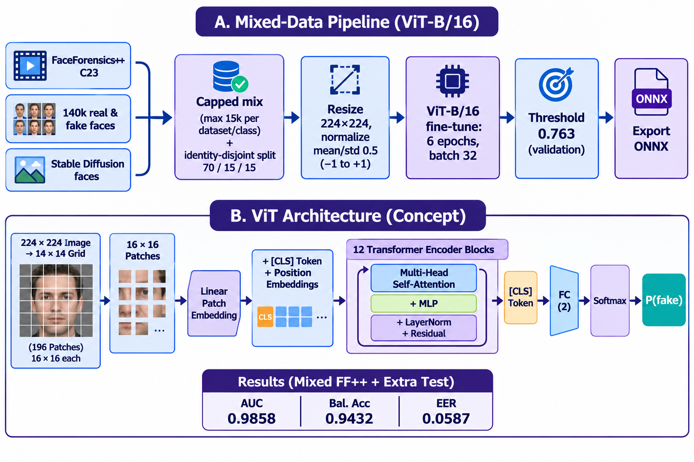

# DeepShield ViT-B/16

An ONNX image classifier for the DeepShield platform, fine-tuned from an ImageNet-pretrained ViT-B/16 on FaceForensics++ C23 and additional real/AI face datasets. This repository contains the model, inference demo, evaluation artifacts, and Kaggle training notebook. It is part of the DeepShield BSCS final-year project at Barani Institute of Sciences, Sahiwal.

The model expects a 224 x 224 RGB image and returns two logits; output index `1` is the fake class. It is an experimental forensic aid, not proof of authenticity. Review [MODEL_CARD.md](MODEL_CARD.md) and the evaluation caveats before using the scores.

## Research pipeline



*Mixed-data training, ViT-B/16 architecture, ONNX export, and held-out test metrics.*

## Structure
```
vit_b16/
├── README.md              this file
├── MODEL_CARD.md          architecture, data, metrics, limits
├── requirements.txt       inference/test dependencies
├── notebooks/             train_vit_b16_mixed_kaggle.ipynb  (train + evaluate + export ONNX)
├── scripts/
│   ├── test_model.py      test the model on a folder of images (accuracy/AUC if real/ and fake/ folders)
│   └── install_model.py   copy the model into the DeepShield project + update models.json
├── demo/                  app.py (Gradio upload-and-see-verdict demo) + requirements.txt
├── weights/               vit_b16.onnx + models_entry_onnx.json  (Git LFS)
├── results/               eval_report.json and curves.png
└── docs/                  model management notes and research pipeline diagram
```

## Quick start
```bash
pip install -r requirements.txt
# test (folders: test_images/real, test_images/fake)
python scripts/test_model.py --model weights/vit_b16.onnx --entry weights/models_entry_onnx.json --images test_images

# demo in browser
pip install -r demo/requirements.txt
python demo/app.py --model weights/vit_b16.onnx --entry weights/models_entry_onnx.json --title "DeepShield ViT-B/16"
# open http://127.0.0.1:7860
```

## Verify the model file

The expected SHA-256 is recorded in `weights/models_entry_onnx.json`. From the repository root:

```powershell
(Get-FileHash .\weights\vit_b16.onnx -Algorithm SHA256).Hash.ToLower()
```

On Linux or macOS, use `sha256sum weights/vit_b16.onnx`. The result must exactly match the manifest's `sha256` value. The checked-in manifest is kept in sync with the ONNX file.

## Train again (Kaggle)
1. Upload `notebooks/train_vit_b16_mixed_kaggle.ipynb`, GPU on, Internet on.
2. Add the `gradientvoyager/faceforensics-c23-extracted-faces-100k` input and the real/AI face datasets used for the run.
3. Save Version -> Save & Run All. Download `vit_b16.onnx`, `models_entry_onnx.json`, `eval_report.json`.

## Install into DeepShield
```bash
cd <deepshield_project>           # folder with manage.py
python <path>/vit_b16/scripts/install_model.py <folder_with_vit_b16.onnx_and_entry_json>
python manage.py check_models
```

## Push to GitHub
See [docs/GITHUB_PUSH.md](docs/GITHUB_PUSH.md). The ONNX weights exceed GitHub's 100 MB regular-file limit and must be committed through Git LFS.

## Disclaimer
Output is a probabilistic aid, not proof. See `MODEL_CARD.md`.
